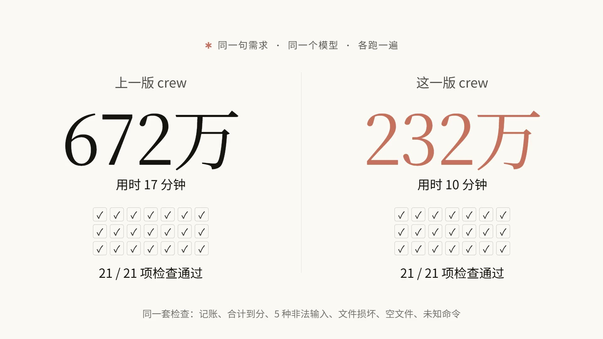

# Crew：带 AI 把项目做完

装进 DeepSeek Harness（DHS）以后，你说一句"用 crew 做 ××"，负责的 AI（Lead）会先把你没说清的地方问清楚，再按项目大小决定自己做还是组队，一直做到能交付。你不用看懂代码，只在几个路口拍板。

[](media/crew-0.8-intro.mp4)

▶ [看 50 秒介绍视频](media/crew-0.8-intro.mp4)：同一句需求、同一个模型，上一版约 672 万、这一版约 232 万，做出来的东西同样通过 21 项检查。

## 它帮你解决什么

用 AI 写东西最常见的翻车：它几秒就说"做完了"，打开一看，要的不是这个、缺一块、一出错满屏英文。原因是你没说的部分它只能猜。Crew 的做法：

1. **先把一句话升级，再找出你没说清的。** 它先想清楚你真正要的结果，把需求往上推一层（例如从"做个记账命令"到"每天 10 秒记一笔、月底一眼看清钱花在哪"），写在流水线目标下面给你看，不同意可以改。你不熟的领域，它先告诉你"这类东西通常要决定哪些事、坑在哪"；再按影响大小一个个问，每题附推荐答案；界面说不清的，先给你看样稿再动手。
2. **做的过程中不偷偷做主。** 遇到计划没写到的情况，它选稳妥的做法，并把"替你定了什么"摆出来给你看，不同意可以改。
3. **完成要有证据。** 提交前要你批准，改了代码必须跑过检查才能收工，交付时告诉你"改了什么、哪里最可能出问题、怎么撤回"。
4. **花费跟项目大小相称。** 小项目 Lead 自己做、只请一个人复查；大项目才组队，而且每个阶段派几个人有上限。

## 安装

1. DHS 左栏 → 插件 → 添加插件 → 本地目录，填本仓库的绝对路径，按提示重启 DHS。
2. 权限模式选"会询问"的那种，这样提交时会弹窗问你。

插件页上它是两行：`crew`（界面）和 `crew/guard`（刹车和工作方法）。只想要工作方法、不要界面，可以关掉 `crew`。

<details>
<summary>装不上或装完不生效</summary>

- 以前把 skill 拷进过 `%USERPROFILE%\.dsh\skills\crew` 的，删掉那份：同名时那份会盖住插件带的这份。
- 以前单独装过 `crew-guard` 或 `crew-center` 的，先在插件页移除再装，否则刹车会挂两遍。
- 插件页提示找不到 `pnpm.mjs`：DHS 安装目录下的运行环境缺失，用官方安装包重装 DHS 即可（会话和配置在 `~/.dsh`，不受影响）。
- 中大项目需要"启用智能体团队协作"。想让每个新会话默认打开，在 `%USERPROFILE%\.dsh\profiles\desktop\cordis.patch.yml` 末尾加上下面几行（先备份；`maxTasks: 256` 是原值，必须一起写）：

  ```yaml
  - id: agent-team
    name: "@deepseek-ai/dsh-agent-team"
    config:
      maxTasks: 256
      defaultEnabled: true
  ```
</details>

## 怎么用

1. 新建会话，说"用 crew 做 <你的项目>"，附上需求、材料或代码所在的文件夹。
2. 回答它的问题。每题都有推荐答案，同意就回"是"。
3. 它把需求整理成一张确认单，你看过没问题就说"需求确认"。之后谁改了它，界面会提醒你重新看。
4. 在这些路口它会停下来等你：需求确认 → 方案（小项目和需求合成一次）→ 界面样子（有界面时）→ 每一段的验收 → 交付。
5. 隔天再来：点左栏"项目"，从"等你的事"或"最近 7 天"点进去；或者说"用 crew 接着做 <文件夹>"。

## 你会看到什么

所有界面都只是看，不会往你的对话里写东西。

- **左栏对话后面的小圆点**：这个项目有事等你（回答问题、选方案、验收、允许提交）。鼠标停上去看是哪几件。
- **左栏"项目"页**：所有项目里等你的事、最近 7 天在做的项目，以及可以收起来的老对话（被新会话接手的旧对话、已交付项目的对话、很久没动的、空的）。收起就是 DHS 自己的归档，随时能找回。
- **对话顶部的"流水线"标签**，从上往下：
  1. 等你的事；
  2. 目标、它把你的需求升级成了什么、需求确认状态，"成功标准 2/6 条已做到"就是进度；
  3. **团队替你定的事**：做的过程中遇到计划外的情况、团队自己做的决定；
  4. 正在做的任务（做完的折叠起来，点开能看每个任务的结果、证据、没验证的地方）；
  5. 用量：负责人和每个成员各用了多少，点开看明细。

## 刹车：写进插件、AI 绕不过去的规矩

只在带 `.team/` 文件夹的项目里生效，别的对话不受影响。

| 刹车 | 什么时候 | 效果 |
|---|---|---|
| 提交要你批准 | AI 要存档（`git commit` / `git push`） | 弹窗问你；同一轮重试不重复弹。你本人在项目里建 `.team/commit-authorized` 表示这一段整批同意。 |
| 不能伪造同意 | 任何时候 | AI 写上面那个文件会被拒绝；偷偷生成的会被删掉并拦下。 |
| 收工前必须验证 | 每一轮准备结束 | 改了代码却没跑通检查，拉回去先检查（每轮最多 2 次）。 |
| 状态不能过期 | 每一轮结束 | 项目状态改了却没同步，或"等你的事"写得你看不懂，拉回去改。 |
| 人数上限 | AI 要再派一个成员 | 超过这个阶段的人数上限（小 1、中 3、大 5）就弹窗问你。 |
| 步数提醒 | 一段对话累计走到 60 步、120 步 | 提醒它收尾；到 120 步要求换新成员接手，别让一段对话越拖越长、越来越贵。 |
| 暂停整个团队 | 你在项目文件夹的 `.team` 里建一个名为 `pause` 的空文件 | 这个项目里所有 AI 的所有操作立刻被拦下（成员之间互相唤醒也没用）；删掉这个文件就继续。想马上止损时用它。 |
| "团队替你定的事"要看得懂 | 成员交回报 | 回报里"偏离"那行带文件名、路径、命令，或超过 80 字，退回让它改成一句大白话；纯技术细节写进它的报告文件。 |
| 里程碑后换会话 | 中/大项目里 Lead 把里程碑往前推了 | 提醒它换新会话接着做，别让一段对话拖过好几个里程碑。 |

权限是"完全访问（从不询问）"时没法弹窗：提交和超出人数会被直接拒绝，AI 会告诉你怎么办。

## 花费

AI 的花费主要取决于"对话有多长 × 走了多少步"，人越多、对话越长越贵。实测（2026-11-17，DHS 里真跑）：

| 项目 | 做法 | 用量 |
|---|---|---|
| 单页打卡小工具 | 旧做法，7 个成员、15 个任务 | 约 1.6 亿 |
| 命令行记账工具 | 旧的轻量通道 | 约 1270 万 |
| 命令行记账工具（同样大小） | 新做法：Lead 自己做 + 1 个评审 | 约 650 万 |
| 家庭共享购物清单（服务端 + 网页 + 命令行，多人同时改） | 新做法：Lead 做 + 方案评审、评审、测试、文档 | 约 3620 万 |
| 番茄钟（单页、带界面，一句话需求） | 新做法：Lead 做 + 1 个评审 | 约 1120 万 |
| 团队任务看板（大项目，6 个里程碑：登录权限、多看板、拖动、实时同步、导入导出、命令行、部署包） | 前 2 个里程碑还没有"累计步数""里程碑后换会话"刹车；后 4 个有 | 共约 3.4 亿：前 2 个约 8000 万/个，后 4 个约 3600 万/个 |

**同题对照**（2026-11-18）：同一句需求（命令行记账：add / list、存本地 JSON、精确到分、要测试）、同一个模型，在两个空文件夹里各跑一遍，只换 crew 版本：

| | 上一版 crew | 这一版 crew |
|---|---|---|
| 用量 | 约 672 万 | 约 232 万（约三分之一） |
| 用时 | 约 17 分钟 | 约 10 分钟 |
| 交付 | 完成，自带 24 个测试 | 完成，自带 8 个测试 |
| 同一套 21 项行为检查（记账、合计到分、5 种非法输入、文件损坏、空文件、未知命令） | 21/21 | 21/21 |
| README | 带真实运行的输出示例 | 只有命令，没有输出示例（已补交付关卡要求） |

小、中、大项目都做完了（大项目只剩"去办公室真机双人验收"这一项要用户本人去做），评审员每一轮都找出了真问题。大项目前半段的钱主要花在 4 个被反复复用的成员身上（每个的对话涨到 27–39 万）；加上"累计步数""里程碑后换会话"两条刹车后，Lead 每个里程碑换新会话、成员每段换新人，每个里程碑的花费降到一半以下。流水线底部的"用量"能看到钱花在了谁身上。

## 已知限制

- 基于 DHS 0.2.2-rc.3。DHS 还在预览阶段，升级后插件可能需要跟着改。
- 提交审批靠识别命令文字；把 git 藏进脚本文件能躲过，兜底是 git 自己的钩子。
- 收工前验证只认文件工具做的改动；用命令行改文件不会触发。
- 人数上限按"项目 + 当前阶段"计数，重启 DHS 后从零算起。
- 用量要 DHS 把数据发给界面才显示；没有数据时这一块不出现。
- 装了改写系统提示词、让模型"把拒绝当重试"的插件时，所有靠自觉的规则都会失效，硬刹车仍然有效。

## 开发

见 [DEVELOPING.md](DEVELOPING.md)：目录结构、依赖的 DHS 接口、测试和升级后的实测清单。

方法来源（借方法，不照抄文本）：[garrytan/gstack](https://github.com/garrytan/gstack)（MIT）、[pbakaus/impeccable](https://github.com/pbakaus/impeccable)、[DietrichGebert/ponytail](https://github.com/DietrichGebert/ponytail)（MIT）、[Yun-BaiBai/plain-to-meta](https://github.com/Yun-BaiBai/plain-to-meta)（MIT），以及 Thariq 关于"先找出未知"的做法。

许可证：[MIT](LICENSE)。
