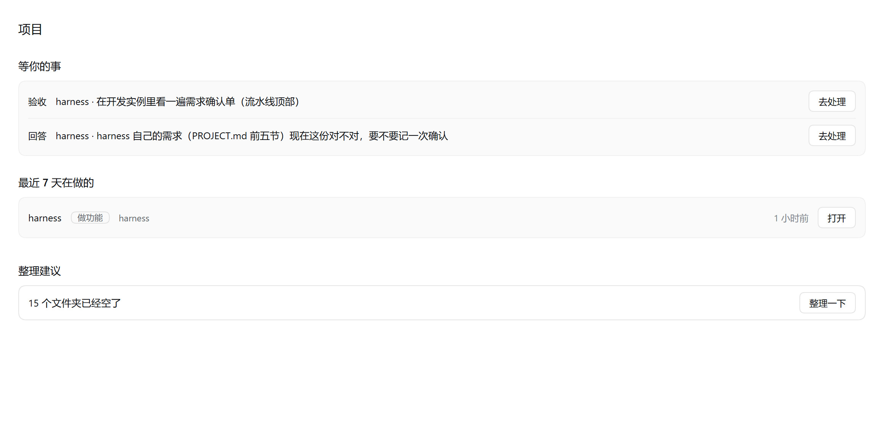
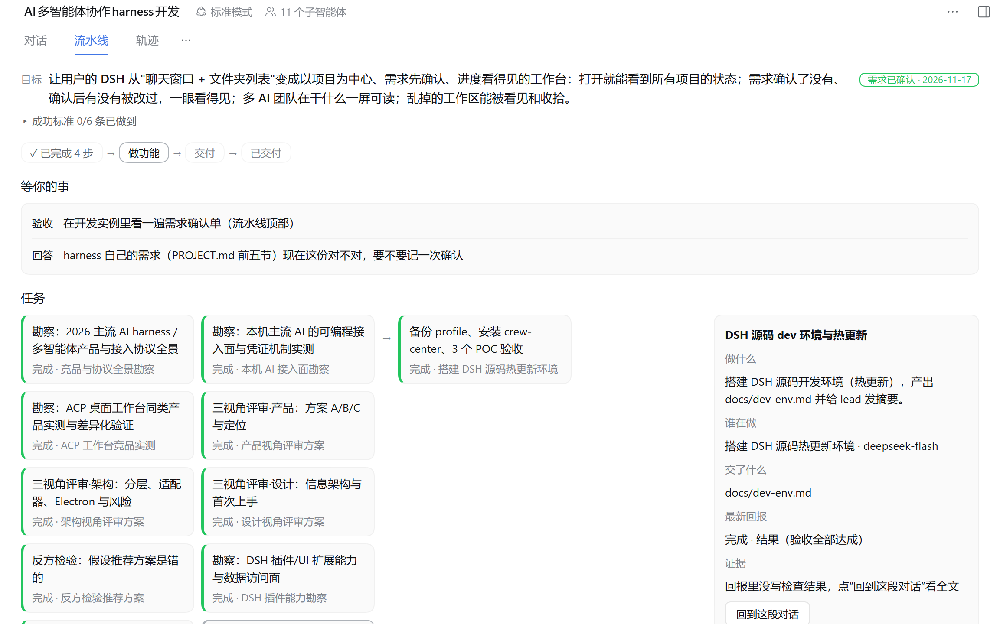

# Crew：让 AI 团队替你把项目做完

Crew 是 DeepSeek Harness（DHS）的插件。你说一句"用 crew 做 ××"，负责的 AI（下面叫 Lead）先把你没说清的地方问清楚，再带着成员一路做到能交付。你不用看懂代码，只在几个路口拍板。

[](media/crew-why.mp4)

▶ [一分钟介绍视频](media/crew-why.mp4)

## 为什么要用它

直接让 AI 做，它几秒就说"做完了"。打开一看，常常要的不是这个、缺了一块，或者一出错就满屏英文。原因很简单：你没说的部分，它只能猜。

Crew 把"猜"换成"问"和"查"：

- **先问清楚再动手。** 它先把你的一句话升级成真正要达到的结果（比如从"做个记账命令"升级到"每天 10 秒记一笔，月底一眼看清钱花在哪"），再按影响大小一个个问你，每题都附推荐答案。界面说不清楚的，先给你看几张样稿让你挑。
- **不偷偷替你做主。** 做的过程中遇到计划外的情况，它会选稳妥的做法，并把"替你定了什么"摆出来给你看，不同意可以改。
- **说做完要拿证据。** 改了代码必须跑过检查才能收工，存档前要你批准，每一段都有评审员挑错。交付时会告诉你：改了什么、哪里最可能出问题、怎么撤回。
- **文档不会过期。** 团队的计划、状态和代码地图强制跟着代码更新，上一段的草稿用完就清掉，免得后面的人照着旧计划跑偏。

需求已经写得很清楚的小事，直接让 AI 做更省。需求只有一句话、里面藏着很多没说的事时，crew 多花的那部分，换来的是"你来定"，而不是"它来猜"。

## 安装

1. DHS 左栏 → 插件 → 添加插件 → 本地目录，填这个文件夹的完整路径，按提示重启 DHS。
2. 权限模式选"会询问"的那种。这样 AI 要存档、要多派人时，会弹窗问你。

装好后，插件页上有两行：`crew`（界面）和 `crew/guard`（工作方法和刹车）。只要工作方法、不要界面，可以关掉 `crew`。

<details>
<summary>装不上，或装完不生效</summary>

- 以前把 skill 拷进过 `%USERPROFILE%\.dsh\skills\crew` 的，删掉那份：同名时它会盖住插件带的这份。
- 以前单独装过 `crew-guard` 或 `crew-center` 的，先在插件页移除再装，否则刹车会挂两遍。
- 插件页提示找不到 `pnpm.mjs`：DHS 安装目录里的运行环境缺失，用官方安装包重装 DHS 即可。你的会话和配置在 `~/.dsh`，不受影响。
- 要多人同时开工，需要打开"启用智能体团队协作"（输入框右下角的模型名 → 开关）。想让新会话默认打开，在 `%USERPROFILE%\.dsh\profiles\desktop\cordis.patch.yml` 末尾加上下面几行（先备份；`maxTasks: 256` 是原来的值，要一起写）：

  ```yaml
  - id: agent-team
    name: "@deepseek-ai/dsh-agent-team"
    config:
      maxTasks: 256
      defaultEnabled: true
  ```
</details>

## 怎么用

1. 新建会话，说"用 crew 做 <你的项目>"，附上需求、材料，或代码所在的文件夹。
2. 回答它的问题。同意推荐答案就回"是"。
3. 它把需求整理成一张确认单。你看过没问题，就说"需求确认"。之后谁改了这张单子，界面会提醒你重新看。
4. 它会在这些路口停下来等你：需求确认 → 方案 → 界面长什么样（有界面时）→ 每一段的验收 → 交付。
5. 隔天再来：点左栏"项目"，从"等你的事"点进去；或者直接说"用 crew 接着做 <文件夹>"。

想马上让整个团队停下：在项目文件夹的 `.team` 里建一个名叫 `pause` 的空文件，所有 AI 立刻停手；删掉它就继续。

## 你会看到什么

这些界面只给你看，不会往你的对话里写东西。

**左栏小圆点**：这个项目有事等你（回答问题、选方案、验收、允许存档）。鼠标停在上面能看到是哪几件。


**"项目"页**：所有项目里等你的事、最近 7 天在做的项目，以及可以收起来的老对话（已被新会话接手的、已交付的、很久没动的、空的）。收起用的是 DHS 自己的归档，随时能找回。



**对话顶部的"流水线"标签**，从上往下依次是：

1. 等你的事；
2. 目标、需求被升级成了什么、需求确认了没有；"成功标准 2/6 条已做到"就是进度；
3. 团队替你定的事；
4. 正在做的任务（做完的会折叠起来，点开能看结果、证据和没验证到的地方）；
5. 用量：负责人和每个成员各用了多少。



## 团队怎么干活

- **派几个人，看有几件事能同时做，不看项目大小。** 只有一条线的活，Lead 自己做；有几件互不相干的事，就同时派几个人一起做；独立的评审员任何时候都保留。不会为了"像个团队"而让几个人排队接力。
- **想得深的地方想得深，干活的地方干得快。** 定方案、做评审的成员用最高档思考；照着方案写代码、跑测试的成员低一档，速度更快。
- **文档只写给 AI 看的部分就写短。** 计划、状态、报告一行一条，不写长篇解释，少写一个字就快一点。给你看的部分（等你的事、交付报告、产品说明书）仍然写成大白话。
- **一份代码地图代替反复翻代码。** 每个代码文件一行：它负责什么、改它要一起看什么、别处依赖它什么、什么地方不能改错。新成员先读地图再动手，不用把整个项目从头翻一遍。

## 刹车：写进插件、AI 绕不过去的规矩

只在带 `.team` 文件夹的项目里生效，别的对话不受影响。

| 刹车 | 什么时候 | 会发生什么 |
|---|---|---|
| 存档要你批准 | AI 要 `git commit` / `git push` | 弹窗问你；同一轮重试不再重复弹。你本人在项目里建 `.team/commit-authorized`，表示这一段整批同意。 |
| 不能伪造同意 | 任何时候 | AI 写上面那个文件会被拒绝；偷偷生成的会被删掉并拦下。 |
| 收工前必须检查 | 每一轮结束 | 改了代码却没跑通检查，会被拉回去先检查。 |
| 状态不能过期 | 每一轮结束 | 项目状态改了却没同步，或者"等你的事"写得你看不懂，会被拉回去改。 |
| 代码地图不能过期 | 成员交"完成"回报、每一轮结束 | 新文件没写进地图、删掉的文件还留在地图里，回报发不出去，要先补上。 |
| 进入下一段前先清旧东西 | Lead 进入下一段、或开始交付 | 上一段的评审稿、演示稿没清，地图和代码对不上，就不能给新的一段派人。 |
| 人数上限 | AI 要再派一个成员 | 超过上限就弹窗问你。能同时做的事有 1 件时上限 1 人，2 件时 3 人，3 件及以上 5 人。 |
| 对话太长要换人 | 一段对话走到 60 步、120 步 | 提醒收尾；到 120 步要求换新成员接手，免得对话越拖越长、越来越贵。 |
| 进入下一段要换会话 | Lead 进入下一段 | 提醒它开新会话接着做。 |
| "团队替你定的事"要看得懂 | 成员交回报 | 写了文件名、路径、命令，或者太长，会被退回，改成一句大白话。 |
| 改完要复审 | 评审之后又改了成品，准备交给你 | 没人复审改过的地方，就不让把成品展示给你、不让标成交付；复审交给原来的评审员，不占人数。 |
| 成功标准逐条打勾 | 交付时 | 一次把所有成功标准全部打勾会被拦下，要每条对着证据打。 |

权限设成"从不询问"时没法弹窗：存档和超出人数会被直接拒绝。开工时 AI 会先告诉你这件事，请你选权限模式；不换的话，整个项目没有存档可以撤回。

## 实测

在 DHS 里真跑过小、中、大三种项目（命令行记账、家庭共享购物清单、6 个阶段的团队任务看板），都做到了交付，评审员每一轮都找出了真问题。

同一句需求、同一个模型、各跑一次的对照（2026-11-18）：

用量是模型读写的文字量，越大越贵。

| 需求 | 不用 crew | 用 crew |
|---|---|---|
| 命令行记账（需求写得很清楚） | 用量约 31 万，3 分钟，21 项检查全过 | 约 232 万，10 分钟，21 项检查全过 |
| 鹈鹕骑自行车动画（只有一句话） | 约 1871 万，23 分钟 | 约 2256 万，53 分钟；先给三张样稿让你挑、确认范围，评审修好 3 个问题 |

拆开看时间花在哪：模型九成的时间花在"写"上，其中大部分是它自己在想；读材料几乎不花时间。所以这一版做了三件事来提速：能同时做的事一起派人、干活的成员降一档思考、只给 AI 看的文档写短。这三项改动还没有在真实项目里重新测过时间。

## 已知限制

- 基于 DHS 0.2.2-rc.3。DHS 还在预览阶段，升级后插件可能需要跟着改。
- 存档审批靠识别命令文字；把 git 藏进脚本文件里能躲过去，兜底是 git 自己的钩子。
- 收工前检查和代码地图检查只认 AI 用文件工具做的改动；用命令行建、删的文件，要到进入下一段时的全面核对才查得出来。
- 地图里每一行写得对不对，程序判断不了，靠评审员核对。
- 人数上限按"项目 + 当前这一段"计数，重启 DHS 后从零算起。
- 装了改写系统提示词、让模型"把拒绝当重试"的插件时，靠自觉的规则都会失效，刹车仍然有效。

## 开发

目录结构、依赖的 DHS 接口、测试，见 [DEVELOPING.md](DEVELOPING.md)。

借鉴的方法（借思路，不照抄文本）：[garrytan/gstack](https://github.com/garrytan/gstack)（MIT）、[pbakaus/impeccable](https://github.com/pbakaus/impeccable)、[DietrichGebert/ponytail](https://github.com/DietrichGebert/ponytail)（MIT）、[Yun-BaiBai/plain-to-meta](https://github.com/Yun-BaiBai/plain-to-meta)（MIT），以及 Thariq 关于"先找出未知"的做法。

许可证：[MIT](LICENSE)。
