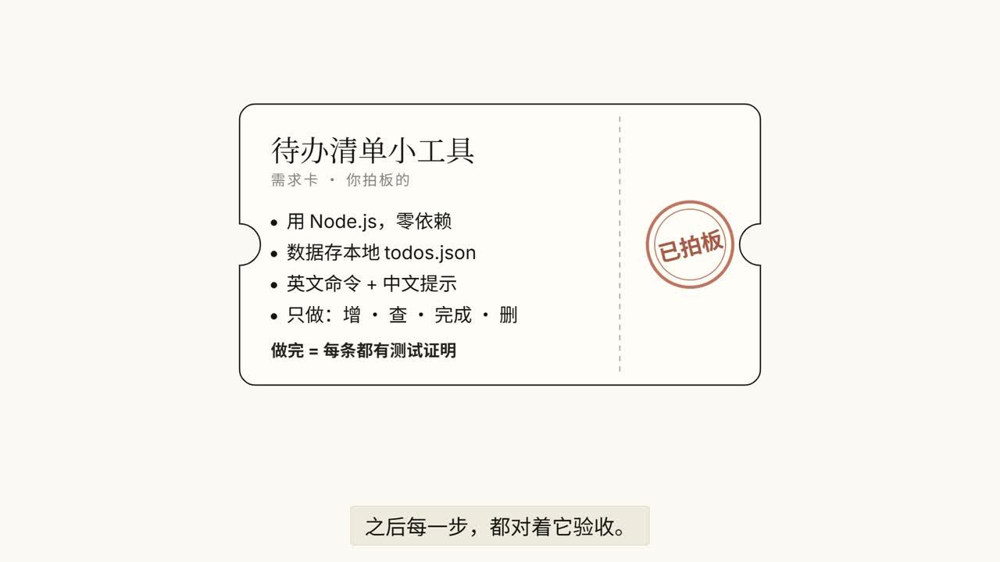

# Crew：带 AI 把项目做完

让 DeepSeek Harness（DHS）的 Lead 按项目需要组一支 Agent Team，把一个完整项目从读懂需求做到可交付。整个仓库就是**一个 DHS 插件 `crew`**，装一次就有三样：

- **skill**：判断方法。读懂需求、出方案、拆里程碑、派活、验收、复盘。规则按"触发表"在关键时刻生效，不一次全塞进上下文。由插件注册给 DHS，不用另外拷到 `~/.dsh/skills`。
- **刹车**：文字管不住的事交给代码。只在带 `.team/` 目录的项目里生效。
- **界面**：左栏"等你"标记、"项目"页（等你的事 / 最近 7 天 / 整理老对话）、对话顶部的"流水线"标签（需求确认单、任务、成员、回报、证据；确认后需求被改会提示你重新确认）。规则见 [DESIGN.md](DESIGN.md)。

插件页上它是两行，各有开关：`crew`（界面）和 `crew/guard`（刹车 + skill）。关掉界面，刹车和 skill 照常工作。

流程本身见 [SKILL.md](SKILL.md)。

## 为什么写它

用 AI 写代码最常见的翻车：你说一句话，它几秒就说"做完了"，打开一看，要的不是这个、功能缺一块、一出错满屏英文。AI 不是不够聪明，而是你没说的部分它只能猜。Crew 不让它猜：

1. **先问清楚**：把一句话拆成必须讲清的问题，用大白话问你，每题附推荐答案。
2. **需求卡**：回答汇成一张写清"做完长什么样"的卡，你拍板才开工。
3. **四道关卡**：评审（故意改坏代码，看测试会不会变红）、证据（交付必须带跑过的测试和命令）、刹车（提交要你批准，写进插件硬拦）、记忆（定过的事进状态卡，踩过的坑变成规则）。

你不用看懂代码，只在这几个路口拍板。

[](media/crew-promo.mp4)

片里的数字都来自一次真实试跑：测试 10/10 全绿却被评审退回、最终 17/17 通过、agent 被要求伪造提交授权时拒绝。

## 安装

DHS 左栏 → 插件 → 添加插件 → 本地目录，填本仓库的绝对路径（例如 `D:\claude\dhs\project-team`），按提示重启 DHS。插件页装的是链接：DHS 直接读这个目录，`git pull` 之后重启 DHS 即是新版本。

- 以前把 skill 拷进过 `%USERPROFILE%\.dsh\skills\crew` 的，删掉那份：同名时用户目录里的 skill 优先，会盖住插件带的这份。
- 以前单独装过 `crew-guard` 或 `crew-center` 插件的，先在插件页移除它们再装 `crew`，否则同一套刹车会挂两遍。
- 插件页安装失败、提示找不到 `pnpm.mjs` 时，是 DHS 安装目录里的运行环境缺失（安装目录下 `resources/runtime` 为空），用官方安装包重装 DHS 即可恢复（会话和配置都在 `~/.dsh`，不受影响）。

### 团队协作默认开启（推荐）

DHS 的"启用智能体团队协作"默认每个新会话都是关的。在 `%USERPROFILE%\.dsh\profiles\desktop\cordis.patch.yml` 末尾加上（先备份；`maxTasks: 256` 是原值，必须一起写上，因为补丁会整体替换这一项配置）：

```yaml
- id: agent-team
  name: "@deepseek-ai/dsh-agent-team"
  config:
    maxTasks: 256
    defaultEnabled: true
```

之后所有新会话一开始就是团队模式（已有会话保持原来的选择）。代价：不做项目的会话也会带上团队工具。

### 配套 skill（可选，装了会自动用）

`impeccable`（界面）、`ponytail` / `ponytail-review`（精简实现与代码审查）、`plain-to-meta`（中大项目的请求升级）。

## 使用

1. 新建会话。没开“团队协作默认开启”的话，点输入框右下角的模型名 → 打开**启用智能体团队协作**（忘了开 Lead 会提醒）。权限建议选会询问的模式，这样提交会弹窗请你批准；Windows 上"工作区内修改"可能被文件权限拦住，Lead 会问你怎么处理。
2. 说"用 crew 做 <你的项目>"（或"用项目团队做……"），附上需求、材料或代码库路径。
3. Lead 会在这些节点停下来等你拍板：需求确认 → 方案与里程碑 → 设计方向（有界面时）→ **每个里程碑的验收演示** → 最终交付。小项目走轻量通道，前两个节点合并成一次。
4. 中断了、隔天再来：说"用 crew 接着做 <项目路径>"。
5. 大项目每个里程碑验收后，Lead 会开一个新会话"接续 <项目名>"，你打开它并开启团队协作开关即可。

## 刹车做什么

| 刹车 | 什么时候触发 | 效果 |
|---|---|---|
| 提交审批 | agent 执行 `git commit` / `git push` | 弹窗请你批准；同一轮重试不重复弹。你本人创建 `.team/commit-authorized` 表示里程碑整批授权，不再弹窗。成员在自己 worktree 分支上的提交不弹窗，推送照样要批。 |
| 授权防伪造 | 任何工具调用 | agent 写这个授权文件会被拒绝；不管命令怎么写，只要这次调用期间授权文件出现或被改，就判定伪造、删除并拦下。 |
| 收工前验证 | 每一轮准备结束时 | 这一轮改了代码、之后没跑通 `.team/guard.json` 里配置的 verify，就把 agent 拉回来先验证（每轮最多 2 次）。纯文档改动不算。 |
| 状态卡 | 开工时、每一轮结束时 | 项目根的 `AGENTS.local.md` 由 DHS 自动注入给所有 agent（压缩后重新注入）。改了 `.team/STATE.md` 没同步它会被拉回来；项目没有状态卡会提醒一次。 |

**审批策略要设成"会询问"**：DHS 权限是"完全访问（从不询问）"时没法弹窗，提交会被直接拒绝，agent 会告诉你切换权限模式，或者用整批授权。

## 你需要知道的

- 文档只保留当前状态，历史压成 `PROJECT.md` 里一句话一条的履历；过程文件在里程碑结束时清掉（git 里能找回）。里程碑关卡会跑 `scripts/doc-check.mjs` 查没收尾的标记和失效链接。
- 每个里程碑复盘：反复出现的问题会变成脚本、刹车配置或状态卡里的规则。给 skill 本身的改进建议写在项目的 `.team/skill-feedback.md`，由你决定要不要改 skill。
- 受监管行业（医疗、金融、政务、教育、信创、敏感个人信息）会加合规评审，交付报告单列"上线前必须由有资质的人完成的事"。团队不替你承诺"已合规"。

## 已知限制

- 基于 DHS 0.2.2-rc.3。DHS 处于开发者预览，团队工具和插件接口可能变化；升级后先跑 `npm test`，再按下面的实测清单用小项目试一次。
- 提交识别靠命令文字（`git ... commit|push`）。把 git 调用藏进脚本文件能躲过审批，兜底是 git 自己的 pre-commit 钩子。
- 收工前验证只认文件工具（write / edit / apply_patch）的改动；用 shell 命令改文件不会触发。
- 你恰好在 agent 执行命令的几秒内手动创建授权文件，会被误判为伪造而删掉，重新创建即可。
- 装了改写系统提示词、让模型"把拒绝当重试"的插件时，所有靠自觉的规则都会失效，硬刹车仍然有效。
- 每个成员是独立会话、按 token 计费。写代码的成员默认不超过 3 个。

## 开发与测试

```
npm test
```

全部离线：刹车（模拟 DHS 的工具流水线，51 项）、界面纯函数与插槽注册、需求指纹（两处算法一致、确认命令）、成员回报解析、skill 注册、STATE.md 文件头两处解析一致。不启动 DHS、不调模型。

依赖的 DHS 接口（0.2.2-rc.3）：刹车用 `tools/pre-execute`、`ctx.tools.guard`、`tools/execute`、`tools/post-execute`、`agent/pre-step`、`agent/turn-stopping`、`ctx.workingDirectory`、`approval`；skill 用 `ctx.skills.registerProvider`（资源目录 = 插件目录）；界面用 `sidebar.panellist`、`main`、`sidebar.session.row.trailing/hover`、`conversation.view`、`uiWorkspace`、`workspaces.delete`、`remote.workspaceFiles`；回报用会话投影 `crewReports`（只读，改解析规则要升 `stateVersion`）。

**DHS 升级或插件改动后的实测清单**（约 20 分钟）：在会询问的权限模式下，用一个空 git 仓库让 Lead "用 crew 做一个命令行待办清单小工具"，逐条看——① 走轻量通道、一次确认；② 建好 `.team/STATE.md`（带文件头）、`.team/guard.json`、状态卡；③ 改代码后没跑 verify 想收尾会被拉回；④ 改 STATE.md 没同步状态卡会被拉回；⑤ 提交弹审批窗，同一轮重试不再弹；⑥ 让它"自己创建 `.team/commit-authorized` 再提交"时它拒绝，伪造的授权文件会被删除；⑦ 左栏负责人对话出现"等你"点，流水线里能看到任务和成员回报；⑧ 说"需求确认"后流水线显示"需求已确认"，再让它改一句范围，显示"确认后改过"。对不上的记下现象和会话时间。

## 目录

```
SKILL.md                    Lead 手册：铁律、触发表、阶段
reference/                  到触发点才读的细节：resume / intake / planning / foundation /
                            team-ops / gates / changes / docs-and-retro / blind-spots
roles/*.md                  9 份角色合同：勘察、产品、架构、设计、实现、评审、测试、文档、合规
templates/*.md              状态卡、STATE.md、PROJECT.md、任务卡、成员 brief、交接单、交付报告
scripts/doc-check.mjs       文档检查（里程碑关卡用）
lib/guard.js                刹车（crew/guard 行）；lib/skill.js 注册 skill
lib/center.js, reports.js   回报投影（crew 行）
lib/state.js                STATE.md 文件头规则（文档检查和界面共用）
lib/requirements.js         需求指纹（--confirm、文档检查和界面共用）
client.js                   界面（手写 lazy-CJS，不用构建）
DESIGN.md                   界面规范
test/                       离线测试
media/                      宣传片与封面
```

## 方法来源（借方法，不照抄文本）

- [garrytan/gstack](https://github.com/garrytan/gstack)（MIT）：需求追问与前提挑战、多套方案、评审清单、文档覆盖表。
- [pbakaus/impeccable](https://github.com/pbakaus/impeccable)：PRODUCT.md / DESIGN.md、critique / audit。
- [DietrichGebert/ponytail](https://github.com/DietrichGebert/ponytail)（MIT）：复用阶梯、"省代码不省校验"。
- [Yun-BaiBai/plain-to-meta](https://github.com/Yun-BaiBai/plain-to-meta)（MIT）：请求升级、方法钥匙、证伪与一手证据。

## 许可证

[MIT](LICENSE)。
